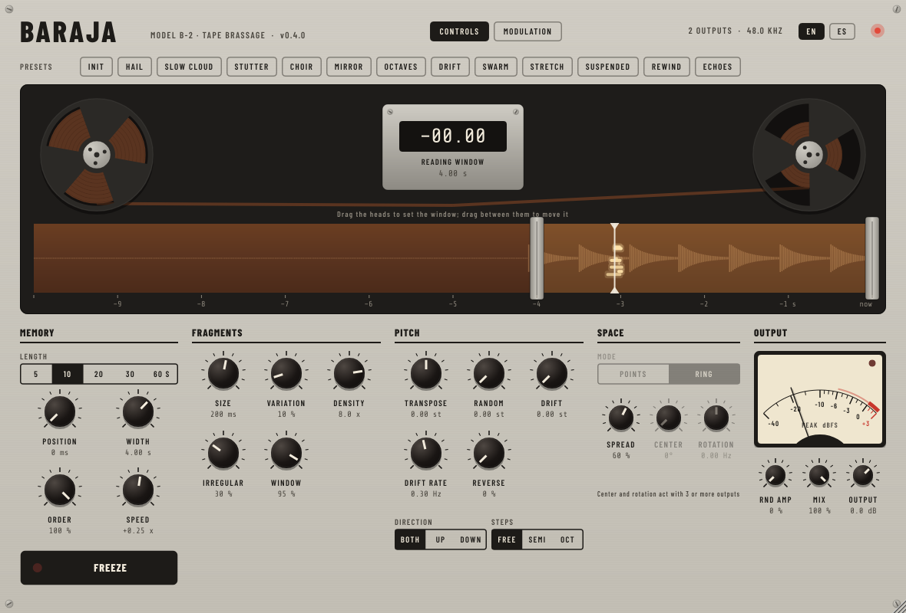

# Baraja

**Brassage en tiempo real** para VST3, CLAP, AU y como aplicación independiente, en macOS y Windows.

Baraja guarda los últimos segundos (de 5 a 60) de lo que entra en una memoria y la recorre tomando fragmentos de tamaño, altura, sentido y posición estéreo variables, que superpone según la densidad elegida. La memoria se puede congelar para seguir barajando lo que quedó guardado aunque la pista quede en silencio.



## Descargar e instalar

1. Entrá a **[Releases](../../releases)** y bajá el paquete de tu sistema: `Baraja-…-macOS.zip` o `Baraja-…-Windows.zip`.
2. Descomprimilo y seguí las instrucciones del archivo `LEEME.txt` que viene adentro. Hay un instalador para cada sistema.

Las versiones de prueba, que todavía no se publicaron como Release, están en la pestaña **[Actions](../../actions)**: abrí la última compilación exitosa y bajá el paquete desde *Artifacts* (hace falta una cuenta de GitHub).

## Novedades de la 0.4: modulación y zoom

- **Modulación**: cuatro fuentes y ocho rutas, en la página **Modulation** (botones *Controls / Modulation* del encabezado).
  - **LFO 1 y LFO 2**: seis formas (senoidal, triángulo, sierra, cuadrada, escalones y azar suave), libres en Hz o atados al tempo del anfitrión (de 4 compases a 1/32, con tresillos), con fase.
  - **FRAG**: un valor al azar nuevo para cada fragmento que nace. Los ajustes que se leen al nacer el fragmento (tamaño, ventana, posición, orden, transposición, reversa, dispersión, centro, amplitud al azar) reciben un valor distinto para cada uno.
  - **FOLLOW** (*Seguidor*): sigue el nivel del sonido que entra, con ataque, caída y ganancia.
  - Cada ruta lleva una fuente a cualquier ajuste continuo (también a la velocidad de los LFO), con una cantidad de −100 a +100 % del recorrido de su perilla. Las rutas son parámetros del DAW: se pueden automatizar.
- **Desde cada perilla**: clic derecho → *Modular con…* LFO 1, LFO 2, FRAG o FOLLOW. Una perilla modulada muestra un arco con su recorrido y un punto que se mueve con la modulación.
- **Zoom en la cinta**: rueda del mouse o pellizco del trackpad, centrado en el cursor. Mayúsculas+rueda, o la barra que aparece arriba de la cinta, para desplazarse; doble clic en la barra para ver toda la memoria. La forma de onda se dibuja con más detalle al acercarse.
- **Fragmentos de 2 ms a 10 s**. Un fragmento no puede durar más que lo que guarda la memoria: con 5 s de memoria llegan hasta unos 5 s, y la perilla muestra el valor real («máx.»).
- Las sesiones de la 0.3 se abren igual que antes (sin modulación).

## Novedades de la 0.3: entre Shuffling y Freeze

- **Order**: en 0, los fragmentos se toman al azar dentro de la ventana, como un *shuffling*. En 100, siguen a un **cabezal de lectura** que recorre la ventana, como un *freeze*. Los valores intermedios mezclan ambos comportamientos.
- **Speed**: velocidad y sentido del cabezal, independientes de la altura. 1 = velocidad original; 0,5 = la mitad (estira el material sin transponerlo); 0 = detenido; valores negativos = hacia atrás.
- El cabezal se ve sobre la cinta y da la vuelta al llegar a los bordes de la ventana.
- Ajustes nuevos: *Stretch* (Estirado), *Suspended* (Suspendido) y *Rewind* (Retroceso).
- Las sesiones de la 0.2 suenan igual que antes, porque Order arranca en 0.

Con la memoria sin congelar, Order 100 y Speed 1 el cabezal acompaña al sonido con un retardo fijo; si además se cambia la transposición, Baraja funciona como un transpositor granular.

## Novedades de la 0.2

- **Skin Tape**: carretes que giran mientras se graba y se detienen al congelar, la memoria como una cinta con su forma de onda, y un medidor de picos con escala en dBFS.
- **Ventana de lectura**: *Posición* (desde qué punto del pasado se lee) y *Ancho* (cuánto abarca). Se ajusta arrastrando los cabezales sobre la cinta; arrastrando entre ellos, la ventana se mueve.
- **Memoria configurable**: 5, 10, 20, 30 o 60 segundos.
- **Multicanal**: de 1 a 64 salidas, con reparto por *puntos* (cada fragmento sale por un altavoz) o en *anillo* (entre dos altavoces vecinos), con centro y rotación.
- **Interfaz en inglés y en castellano** (botones EN / ES); los parámetros aparecen en inglés en el DAW.
- Las sesiones guardadas con la 0.1 se abren con sus valores: la antigua *Profundidad* pasa a ser el *Ancho*.

## Parámetros

| Grupo | Parámetro | Qué hace |
|---|---|---|
| Memory | Length | Duración de la memoria: 5 a 60 s. Cambiarla vacía la memoria. |
| | Position | Desde qué punto del pasado empieza la ventana de lectura (0 = ahora). |
| | Width | Cuánto abarca la ventana de lectura. |
| | Order | 0 = fragmentos al azar en la ventana (shuffling); 100 = siguen al cabezal de lectura (freeze). |
| | Speed | Velocidad y sentido del cabezal (−4 a +4), independientes de la altura. 0 = detenido. |
| | Freeze | Deja de grabar y sigue barajando lo guardado. |
| Fragments | Size | Duración media de cada fragmento (2 ms a 10 s, según lo que entre en la memoria). |
| | Variation | Cuánto cambia la duración de un fragmento a otro. |
| | Density | Cuántos fragmentos suenan superpuestos en promedio. |
| | Irregular | 0 = fragmentos a intervalos regulares; 100 = totalmente irregulares. |
| | Window | Forma de la envolvente de cada fragmento: de bordes abruptos a campana. |
| Pitch | Transpose | Transpone todos los fragmentos en la misma proporción (±24 semitonos). |
| | Random | Cada fragmento recibe además una altura al azar dentro de este rango. |
| | Drift / Drift rate | La transposición vaga sola en el tiempo. |
| | Reverse | Probabilidad de que un fragmento se lea al revés. |
| | Direction | La variación aleatoria va hacia ambos lados, solo hacia arriba o solo hacia abajo. |
| | Steps | Alturas libres, cuantizadas a semitonos o a octavas. |
| Space | Mode | Con 3 salidas o más: *Points* (un altavoz por fragmento) o *Ring* (entre dos vecinos). |
| | Spread | Cuánto se reparten los fragmentos: en estéreo, el panorama; en multicanal, la porción del anillo. |
| | Center | Multicanal: centro del reparto sobre el anillo, en grados. |
| | Rotation | Multicanal: vueltas por segundo del centro alrededor del anillo. |
| Output | Rnd amp | Variación de nivel al azar entre fragmentos. |
| Modulation | LFO 1, LFO 2 | Forma, Sync (libre / anfitrión), velocidad en Hz o división del tempo, fase. |
| | Follow | Ataque, caída y ganancia del seguidor de nivel de la entrada. |
| | Route 1…8 | Fuente (LFO 1, LFO 2, FRAG, FOLLOW), ajuste de destino y cantidad (−100 a +100 %). |
| | Mix | Proporción entre señal original y procesada. En multicanal, la original sale por 1 y 2. |
| | Output | Ganancia final. |

Doble clic sobre un control lo vuelve a su valor inicial. Los ajustes de fábrica también aparecen en la lista de presets del DAW.

## Multicanal en Reaper

1. En la pista, abrí el botón de ruteo y poné *Track channels* en la cantidad de salidas que necesites (por ejemplo 8, 16 o 64).
2. Insertá **Baraja (VST3)**. El plugin se adapta a la cantidad de canales de la pista: el encabezado muestra cuántas salidas está usando.
3. Mandá cada canal de la pista a la salida de hardware que corresponda (o a otras pistas para seguir procesando).

En esta versión el formato **CLAP funciona en estéreo**; para multicanal usá el **VST3** o la aplicación independiente, que abre todas las salidas de la placa elegida en *Options*.

## Compilar desde el código

Hace falta CMake 3.22 o posterior y un compilador de C++17: Xcode o sus Command Line Tools en macOS, Visual Studio 2022 en Windows. JUCE y la extensión CLAP se descargan solos.

```
cmake -B build -DCMAKE_BUILD_TYPE=Release
cmake --build build --config Release
ctest --test-dir build -C Release
# opcional: pruebas como host y capturas de la interfaz
cmake -B build -DBARAJA_SNAPSHOT=ON
```

Cada cambio que se sube a `main` se compila automáticamente para macOS (universal) y Windows, se prueba y se valida con [pluginval](https://github.com/Tracktion/pluginval). Para publicar una versión, se crea una etiqueta `vX.Y.Z`.

### Estructura

- `Source/BarajaEngine.h`: el motor de audio, independiente de JUCE.
- `Source/Parameters.h`: parámetros y ajustes de fábrica.
- `Source/PluginProcessor.*`: el plugin (buses, memoria, estado).
- `Source/PluginEditor.*`: la skin Tape.
- `Resources/fonts/`: tipografías Barlow Condensed y Share Tech Mono (licencia SIL Open Font).
- `tests/`: prueba del motor, prueba como host VST3 (hasta 64 salidas) y herramienta de captura de la interfaz.
- `instalar/`: instaladores e instrucciones que viajan en cada paquete.

## Licencia

Copyright © 2026 Lautaro Martín Vieyra.
Baraja es software libre bajo la [GNU Affero General Public License 3.0](LICENSE) o posterior: se puede usar, estudiar, compartir y modificar, siempre que las versiones modificadas que se distribuyan mantengan la misma licencia y su código abierto.

Usa [JUCE](https://juce.com) (AGPL 3.0) y [clap-juce-extensions](https://github.com/free-audio/clap-juce-extensions) (MIT). Tipografías: [Barlow](https://github.com/jpt/barlow) y [Share Tech Mono](https://fonts.google.com/specimen/Share+Tech+Mono), ambas bajo SIL Open Font License 1.1 (`Resources/fonts/`).
VST es una marca registrada de Steinberg Media Technologies GmbH.
